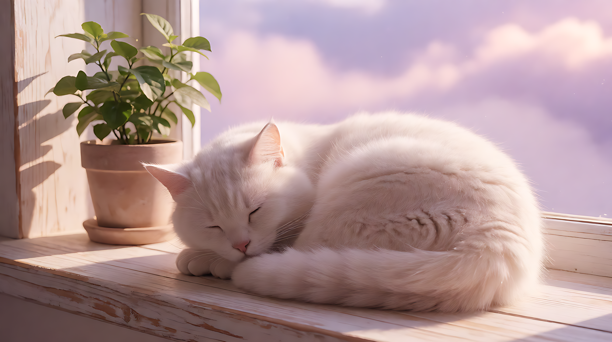
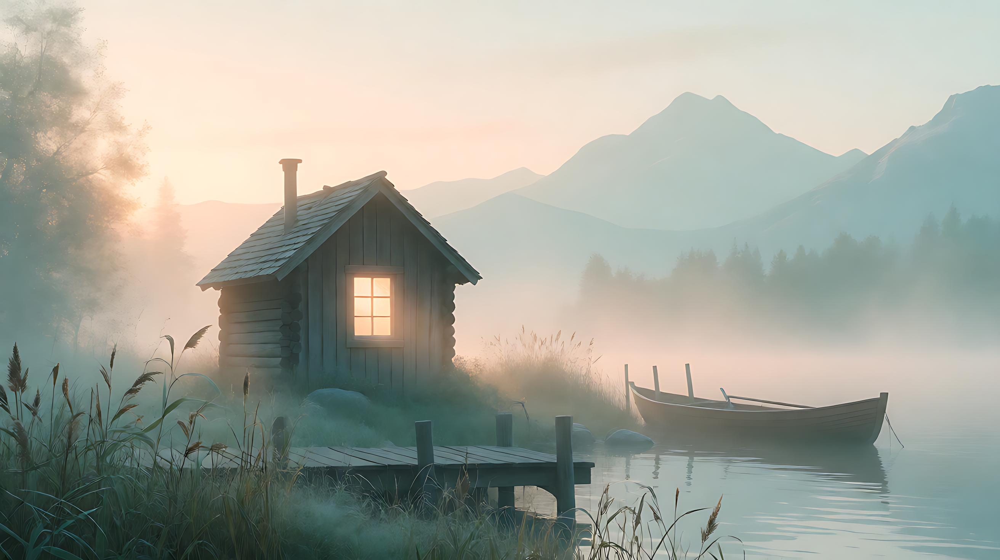
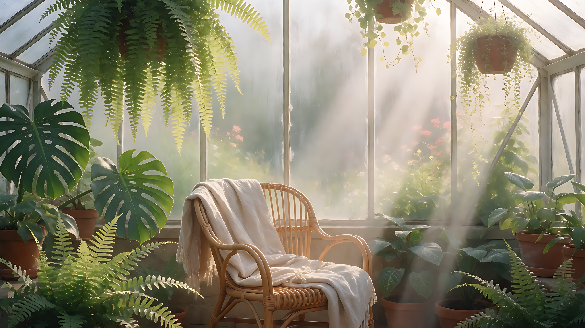
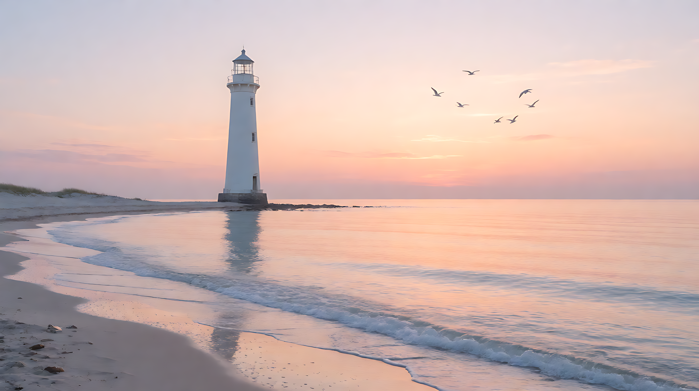
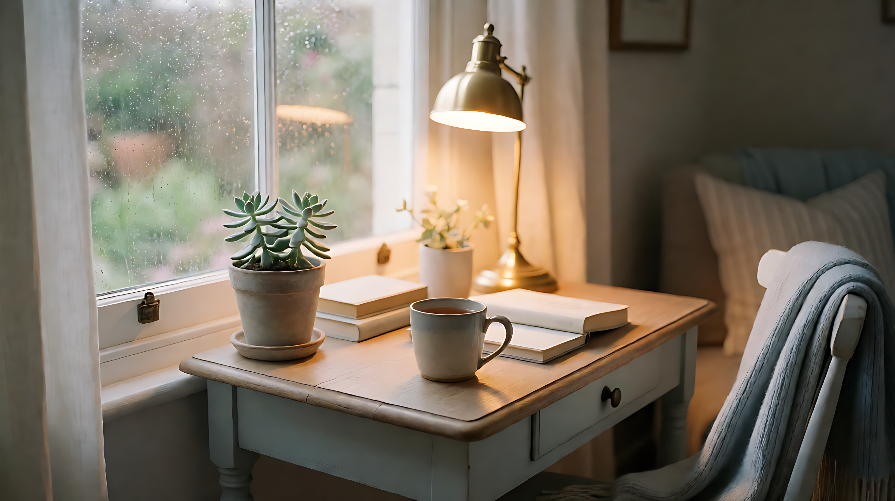
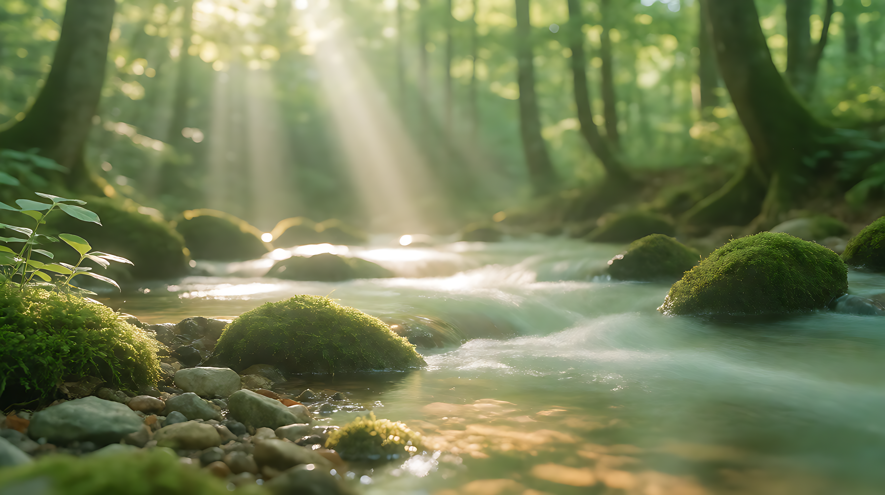
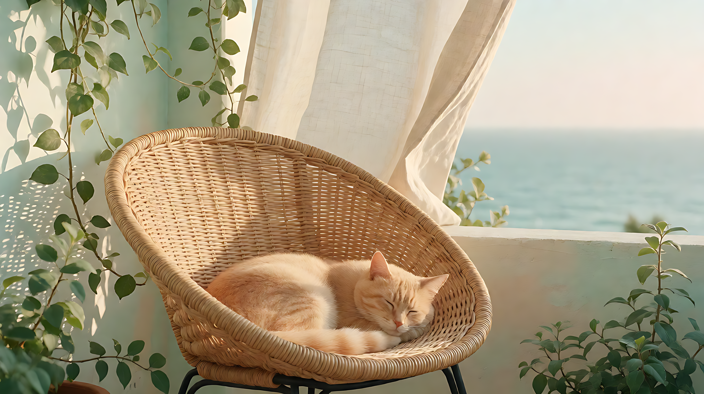
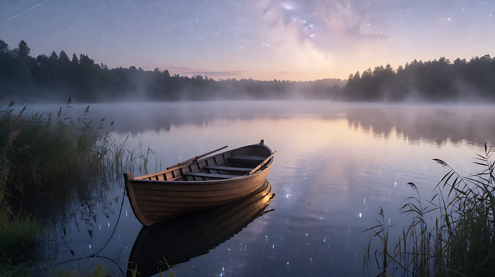

# @lingxinsuixing/dsh-agnes

Agnes AI **image generation** and **video generation** for [DeepSeek Harness](https://github.com/DeepSeek-Harness) — plus an **optional** image recognition that can be switched off.

> **Tool results are text-only.** Generated images and videos are downloaded to a local folder; the tool returns the file path and the URL, never the image bytes.

## Install

~~~sh
dsh plugin add github:lingxinsuixing/dsh-agnes
~~~

This is the same command the DSH plugin marketplaces print. The package has no build
step, so nothing has to be approved before it installs.

## Configure

Open **Plugins → @lingxinsuixing/dsh-agnes** in the Web UI and paste your Agnes API key, or use the DSH credential store:

~~~yaml
# ~/.dsh/credentials.yaml  (or the credential store in the Web UI)
AGNES_API_KEY: your-key
~~~

The key is looked up in this order: the plugin config (`config.apiKey`) → the credential store entry `AGNES_API_KEY` → the environment variable `AGNES_API_KEY`.

> The key you type in the settings page is written to your **own profile** as `config.apiKey` in plain text. It is never written into the package, and the package ships without any credential.

## Tools

| Tool | What it does | Key parameters |
|---|---|---|
| `agnes_image_generate` (main) | Generates or edits an image from a text prompt | `prompt`, `size`, `ratio`, `references`, `saveTo` |
| `agnes_video_generate` (main) | Generates a video from a text prompt | `prompt`, `mode`, `seconds`, `size`, `aspectRatio`, `images`, `saveTo` |
| `agnes_image_recognize` (optional) | Describes or answers questions about an image | `image` (local path or http(s) URL), `prompt` |

Every tool returns text: a path, a URL and a short summary. Nothing binary is put into the conversation.

Note on `size`: the API maps an exact size such as `1920x1080` to the nearest tier, so the `size` in the
result is the **real pixel size of the file on disk**, not necessarily what was asked for.

## Samples

Real output from `agnes_image_generate` (2K, 16:9), produced with this plugin:

| | |
|---|---|
|  |  |
|  |  |
|  |  |
|  |  |
|  |  |

## Optional: image recognition

Image recognition is optional. Set `enableRecognition: false` in the plugin config and the
`agnes_image_recognize` tool is not registered at all — only image and video generation stay.

> **Statement.** Recognition works without changing the provider: this tool is independent of whether DSH
> talks to Agnes over `openai-responses` or `openai-completions`. Only DSH’s own
> `read_image` requires the provider to be switched to `openai-completions`; without that switch, do not
> give the model image input, because one `read_image` bricks the whole conversation.

If your provider talks to Agnes over `api: openai-completions`, declare `reasoningEfforts` in the model entry as well.
Without it DSH does not send `reasoning_effort`, the gateway returns no `reasoning_content`, and the model writes its whole
reasoning process into the message body — the thinking chain ends up in the conversation.

### Do not use `read_image` inside the main conversation

> Once a model is marked as supporting images, the built-in `read_image` puts an image content block into
> the conversation. The Agnes gateway `/v1/responses` endpoint does not understand `input_image`
> (its responses→chat bridge falls back to `unknown`), so the next request fails with a 400. A 400 is
> not retried, and every turn rebuilds the whole history from the session log — one bad message bricks
> the entire conversation and you have to start a new one. Use `agnes_image_recognize` instead: the
> image goes to the Agnes vision model and only text comes back into the conversation.

## Where output goes

Generated media is written to the folder configured as `outputDir` (default: `media/` under the DSH home directory: `$DSH_HOME/media`, or `~/.dsh/media` when `$DSH_HOME` is not set). Each call returns the absolute path of the file it wrote.

A `saveTo` argument must point to an **existing** directory: the plugin never creates directories at arbitrary paths, and file names are generated by the plugin, so nothing of yours is overwritten.

Local images read by the recognition tool can be restricted with `allowedReadRoots` (a list of absolute folders). Empty = any readable image file is accepted.

## Requirements

- DeepSeek Harness with `@deepseek-ai/schemastery` `>=3.18.1`
- An Agnes API key
- Agnes image generation is currently free; video generation is billed by Agnes per generated second (the `-flash` variant is currently limited to 720P)

## License

MIT
